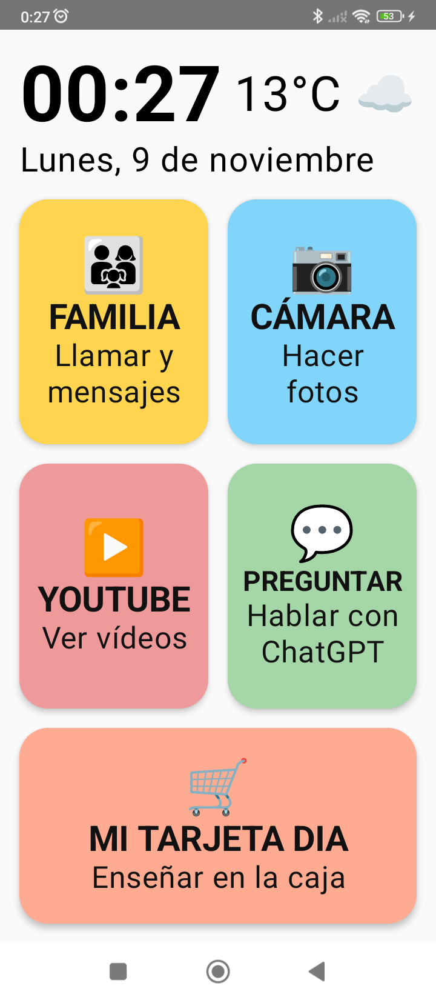
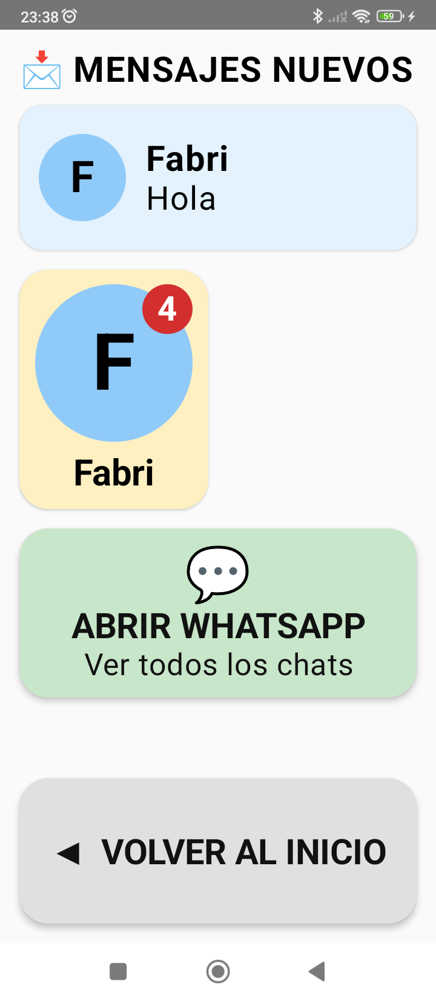
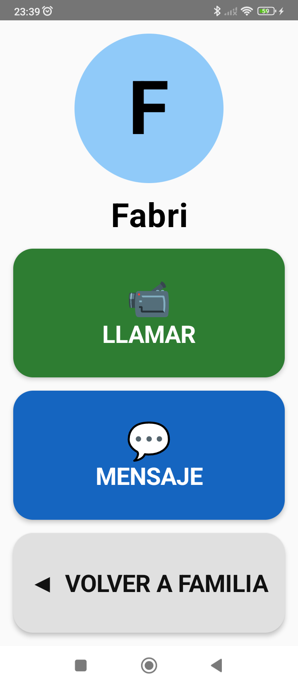
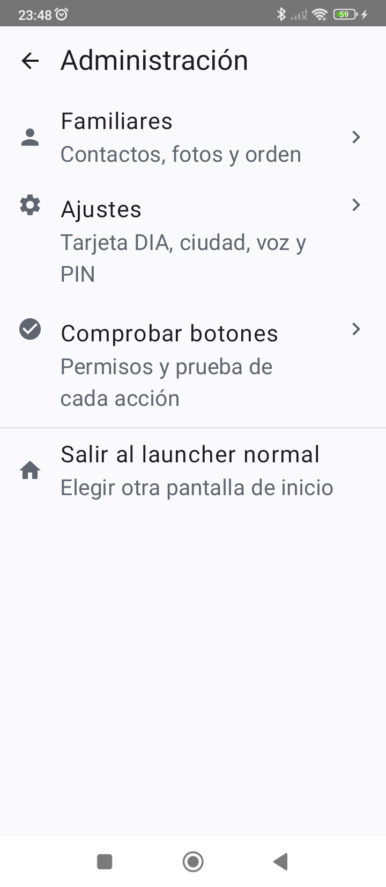
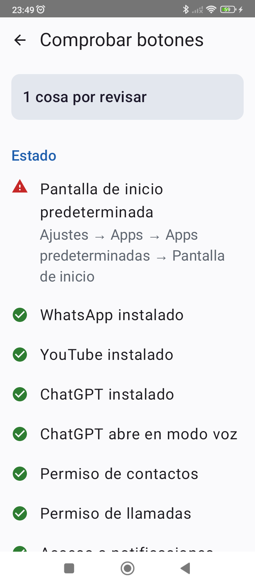

# Inicio Nonna — a simple Android home screen for my grandmother

An Android launcher built in Kotlin + Jetpack Compose that replaces the home screen of my 80-year-old
grandmother's phone with five big, colour-coded buttons. It was designed around her real difficulties —
accidental taps and getting lost inside apps — and tested with her every day on her Xiaomi Redmi.

<p align="center">
  
  
  
  
  
</p>

> The UI is in Spanish because it is built for her. Screens, in order: home · family with new messages ·
> call or message a relative · admin area · built-in diagnostics.

## What it does

| Button | What happens |
|---|---|
| **FAMILIA** | Big photo cards of relatives. Tap one → **LLAMAR** starts a WhatsApp video call directly; **MENSAJE** opens the chat. New WhatsApp messages appear on top with an unread badge. |
| **CÁMARA** | Opens the camera straight in photo mode. |
| **YOUTUBE** | Opens YouTube. |
| **PREGUNTAR** | Opens ChatGPT **directly in voice mode**, so she can just talk. |
| **MI TARJETA DIA** | Shows her supermarket loyalty card as a full-screen QR / barcode at maximum brightness. |

Plus: clock, date and current temperature (Open-Meteo) at the top; spoken feedback for every button;
incoming calls forced to full screen; and a PIN-protected admin area (hidden behind 5 quick taps on the
clock) for the family to manage contacts, settings and diagnostics.

## Designing for an 80-year-old

- **Accidental taps:** every button has a debounce window, and anything that reaches outside the app
  (a call) needs two taps on two different screens. The debounce resets when a confirmation screen
  opens, so a double tap can never hit "call" by accident.
- **No dead ends:** every screen has the same big "back" button in the same place, and the system home
  button always returns to the launcher.
- **Readable at a glance:** distinct colours and an emoji per action, titles that shrink to fit on one
  line instead of breaking words, and text sized for a phone with an enlarged system font.
- **Graceful fallbacks:** each action has ordered fallback plans (e.g. video call → chat → open WhatsApp),
  and a friendly error screen tells her who to ask for help.
- **Two audiences, two designs:** the grandmother screens use huge buttons; the admin area uses a
  standard, minimal Material 3 look because it's for the family.

## Interesting problems solved

These came from testing on the real device, not from the documentation:

- **Direct WhatsApp video calls.** The launcher looks up WhatsApp's `video.call` row in the system
  Contacts provider and fires it at WhatsApp. It silently fell back to the chat until logs showed a
  `SecurityException`: WhatsApp's call activity requires the caller to hold `CALL_PHONE`.
- **ChatGPT straight into voice mode.** The app's voice shortcut can only be launched by the default
  launcher. Reading the APK's intent filters led to a deep link (`https://chatgpt.com/voice`) that opens
  voice mode from anywhere.
- **Reading WhatsApp messages.** A `NotificationListenerService` extracts `MessagingStyle` messages,
  de-duplicates them and matches senders to family members (accent-insensitive, via phone numbers).
  On MIUI the listener stays unbound after every app update, so the app detects it and re-binds itself
  by toggling its own component.
- **Full-screen incoming calls.** Android only shows a call's full-screen intent when nobody is using
  the phone — and a launcher is always "in use". The listener detects incoming `CATEGORY_CALL`
  notifications and launches their full-screen intent itself, once per call.

## Architecture

```
app/src/main/java/com/fabri/nonna/
├── acciones/     Lanzador (pure: action → ordered fallback plans) + Ejecutor (Android intents)
├── mensajes/     Notification listener, message inbox, sender matching, incoming-call handling
├── navegacion/   State-based navigation (sealed Pantalla) and the click Controlador
├── datos/        DataStore repository + kotlinx.serialization models
├── tiempo/       Open-Meteo client and cache
├── seguridad/    Salted SHA-256 PIN, lockout, tap counter
├── dia/          QR / Code 128 generation with ZXing
├── admin/        Diagnostics checks
└── ui/           Compose screens (home, family, DIA card, admin, components, theme)
```

Business rules live in plain Kotlin objects with no Android dependencies, so they're covered by fast
JVM unit tests; thin adapter classes do the Android work.

## Tech stack

Kotlin 2.2 · Jetpack Compose (Material 3) · DataStore · kotlinx.serialization · ZXing ·
Open-Meteo API · TextToSpeech · NotificationListenerService · LauncherApps · ContactsContract ·
JUnit 4 · minSdk 29, targetSdk 37.

## Tests

82 JVM unit tests cover the pure logic: phone-number normalisation, fallback plans, debounce, the
message inbox and sender matching, incoming-call detection, PIN hashing and lockout, weather parsing
and caching, barcode generation and settings serialisation.

```bash
./gradlew testDebugUnitTest
```

## Process

The project was planned with a written design spec and step-by-step implementation plans before any
code was written (see [`docs/superpowers/`](docs/superpowers/)), then built test-first and verified on
the real phone over adb (screenshots, logcat, `dumpsys`). Next on the roadmap: medication reminders
with a "taken" confirmation and a family alert — its spec and plan are already in `docs/`.

## Running it

1. Open the project in Android Studio and run it on a device (Android 10+).
2. Set **Inicio Nonna** as the default home app.
3. Follow the first-run wizard: create a PIN, grant contacts/calls and notification access, add relatives.

See [`docs/guia-instalacion.md`](docs/guia-instalacion.md) for the full on-device setup (in Spanish),
and [`docs/chatgpt-plantilla.md`](docs/chatgpt-plantilla.md) for the ChatGPT personalisation template
used for voice conversations.

---

Built with ❤️ for my Nonna.
